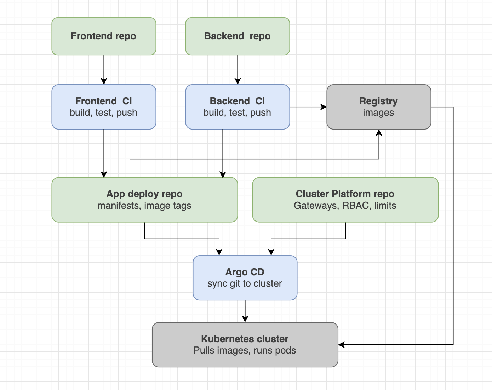

[Документация](https://argo-cd.readthedocs.io/en/stable/)

Argo CD это GitOps: состояние кластера описано в git, а Argo CD приводит кластер к этому состоянию. CI в кластер ничего не применяет, он только собирает образ и коммитит новый тег в репу с манифестами.

Приложение, Gitea, раннер, локальные репозитории и установку по шагам можете найти в проекте [zero-to-cluster](https://github.com/kuzz0k/zero-to-cluster): [как устроен CI/CD](https://github.com/kuzz0k/zero-to-cluster/blob/main/docs/architecture-overview/CICD%20и%20GitOps.md), [установка](https://github.com/kuzz0k/zero-to-cluster/blob/main/docs/setup/CICD%20и%20GitOps.md), [Applications](https://github.com/kuzz0k/zero-to-cluster/tree/main/app-deploy/argocd).



### Установка

```
kubectl create namespace argocd
kubectl apply -n argocd --server-side --force-conflicts -f https://raw.githubusercontent.com/argoproj/argo-cd/stable/manifests/install.yaml
```

```
kubectl -n argocd get pods
```

Может не спулиться redis (проблема с пулом слоев), тогда подменяем на зеркало:

```
sudo k3s crictl pull mirror.gcr.io/library/redis:8.2.3-alpine
kubectl -n argocd set image deploy/argocd-redis redis=mirror.gcr.io/library/redis:8.2.3-alpine
kubectl -n argocd rollout status deploy argocd-redis
kubectl -n argocd rollout restart deploy argocd-server
```

### Доступ через Gateway

TLS снимается на Gateway, внутри кластера трафик идет по http, поэтому у Argo CD выключаем https и вешаем его на `/argocd`, [argocd-cmd-params-cm.yaml](install/argocd-cmd-params-cm.yaml):

```
data:
  server.insecure: "true"
  server.basehref: /argocd
  server.rootpath: /argocd
```

```
kubectl -n argocd rollout restart deploy argocd-server
kubectl apply -f install/httproute.yaml
```

В [HTTPRoute](install/httproute.yaml) стоит `timeouts.request: "0s"`, чтобы не обрывались долгие запросы UI.

Envoy по умолчанию декодирует `%2F` в `/` и склеивает `//`. UI Argo CD передает URL репозитория прямо в пути, после такой нормализации получаем 404 при создании приложения. Лечится `ClientTrafficPolicy`, см. [Envoy + MetalLB](<../../../kubernetes/05-network/gateway-api/envoy-metallb/Envoy + MetalLB.md>)

### Пользователи

При первом запуске создается `admin`, пароль в секрете:

```
kubectl -n argocd get secret argocd-initial-admin-secret -o jsonpath='{.data.password}' | base64 -d; echo
```

Заходим, меняем пароль и удаляем секрет:

```
kubectl -n argocd delete secret argocd-initial-admin-secret
```

Свои пользователи заводятся в `argocd-cm`, права в `argocd-rbac-cm`: [argocd-cm.yaml](install/argocd-cm.yaml), [argocd-rbac-cm.yaml](install/argocd-rbac-cm.yaml)

```
data:
  accounts.ubuntu: login, apiKey   # login - вход в UI, apiKey - токены для CI
```

```
data:
  policy.default: role:readonly
  policy.csv: |
    g, ubuntu, role:admin
```

Без `policy.default` и правил у нового пользователя прав нет. Встроенные роли `role:admin` и `role:readonly`, свои правила пишутся так: `p, ubuntu, applications, sync, default/*, allow`

Пароль задает admin:

```
argocd account update-password --account ubuntu --current-password <пароль admin> --new-password <новый>
```

Когда есть свой админ, дефолтный можно выключить через `admin.enabled: "false"` в `argocd-cm`

### Репозиторий

Публичную репу подключать не надо, достаточно url в Application. Для приватной создаем секрет с лейблом `argocd.argoproj.io/secret-type: repository` ([repo-secret.yaml](examples/repo-secret.yaml)) или через UI Settings → Repositories.

### Application

Что и куда деплоить, [application.yaml](examples/application.yaml):

```
spec:
  destination:
    namespace: app
    server: https://kubernetes.default.svc
  sources:
    - path: backend
      repoURL: http://192.168.1.205:3000/user1/cluster-platform-repo.git
      targetRevision: main
    - path: frontend
      repoURL: http://192.168.1.205:3000/user1/cluster-platform-repo.git
      targetRevision: main
  syncPolicy:
    automated:
      prune: true      # удалять из кластера то, что удалено из git
      selfHeal: true   # откатывать ручные правки в кластере
    syncOptions:
      - CreateNamespace=true
```

Если в папке лежит `kustomization.yaml`, Argo CD сам понимает, что это Kustomize. С `selfHeal` ручной `kubectl edit` откатится, все меняется только через git.

Создать можно `kubectl apply -f application.yaml` или в UI NEW APP → EDIT AS YAML. Для нескольких sources и `ignoreDifferences` только через YAML, в форме их нет. В обоих случаях Application живет только в кластере, не в git.

При создании через UI в DevTools будет `403` на `GET /api/v1/applications/<name>`, это нормально, так Argo CD отвечает на несуществующее приложение.

### Helm чарт + values из своей репы

Так ставил мониторинг и логи ([monitoring](../../observability/metrics/kube-prometheus-stack/application.yaml), [logging](../../observability/logging/loki-alloy/application.yaml)). Чарт берется из helm репы, values из своей git репы через `ref`:

```
  sources:
    - repoURL: https://prometheus-community.github.io/helm-charts
      chart: kube-prometheus-stack
      targetRevision: 92.13.1          # версия чарта, для обновления меняю и пушу
      helm:
        releaseName: monitoring
        valueFiles:
          - $values/monitoring/values.yaml

    - repoURL: http://192.168.1.205:3000/user1/cluster-platform-repo.git
      targetRevision: main
      ref: values                       # отсюда берется $values

    - repoURL: http://192.168.1.205:3000/user1/cluster-platform-repo.git
      targetRevision: main
      path: monitoring/extras           # обычные манифесты рядом с чартом
```

```
  syncPolicy:
    syncOptions:
      - ServerSideApply=true   # CRD оператора слишком большие для обычного apply
    retry:
      limit: 5
      backoff:
        duration: 10s
        factor: 2
        maxDuration: 3m
```

`ignoreDifferences` для полей, которые после установки меняет кто-то другой (тут `caBundle` у вебхуков патчит Job), иначе приложение вечно OutOfSync:

```
  ignoreDifferences:
    - group: admissionregistration.k8s.io
      kind: MutatingWebhookConfiguration
      jqPathExpressions:
        - .webhooks[]?.clientConfig.caBundle
        - .webhooks[]?.failurePolicy
```

### Связка с CI

1. Пуш в main фронта или бэка
2. CI собирает образ и пушит с тегами `1.0.<run_number>` и `sha-<short_sha>`
3. Второй job клонирует репу манифестов, меняет `newTag` в `kustomization.yaml` и пушит коммит `backend: 1.0.42`
4. Argo CD видит коммит и применяет, Deployment выкатывается через rolling update

Тег меняется через [Kustomize](../../packaging/kustomize/Kustomize.md), Deployment не трогается:

```
sed -i "s/^\(\s*newTag:\).*/\1 \"${IMAGE_VERSION}\"/" backend/kustomization.yaml
git diff --exit-code && { echo "Тег не изменился"; exit 0; }
```

Пуш повторяется до 3 раз с `git pull --rebase`, на случай если фронт и бэк коммитят одновременно. Весь workflow: [gitea-ci-bump-tag.yml](examples/gitea-ci-bump-tag.yml)

Для пуша нужен токен со scope `write:repository` (лучше от отдельного бота), лежит в секретах репы как `MANIFESTS_TOKEN`.

### Webhook

Argo CD опрашивает git раз в 3 минуты (`timeout.reconciliation` в `argocd-cm`). Чтобы выкатка шла сразу, в Gitea webhook на `https://app.local/argocd/api/webhook` (тип Gitea, событие push).

Чтобы webhook дошел:
- Gitea должна резолвить `app.local`, Gateway маршрутизирует по имени хоста. В `/etc/hosts` на машине с Gitea: `192.168.1.181  app.local`
- В `app.ini` Gitea разрешить приватные адреса и самоподписанный серт, потом рестарт:

```
[webhook]
ALLOWED_HOST_LIST = private
SKIP_TLS_VERIFY = true
```

### Полезное

Какие ресурсы управляются Argo CD:

```
kubectl -n app get deploy -o custom-columns='NAME:.metadata.name,ARGO:.metadata.annotations.argocd\.argoproj\.io/tracking-id'
```

```
kubectl -n argocd get application
```

HTTPRoute (и другие CRD) под Argo CD вечно OutOfSync: API server дописывает дефолты `group`, `kind`, `weight` в `parentRefs`/`backendRefs`, а Argo CD сравнивает элементы списка целиком и бесконечно делает self-heal. Лечится тем, что дефолты прописаны в манифесте явно, пример в [grafanaHTTPRoute.yaml](../../observability/metrics/kube-prometheus-stack/extras/grafanaHTTPRoute.yaml)
