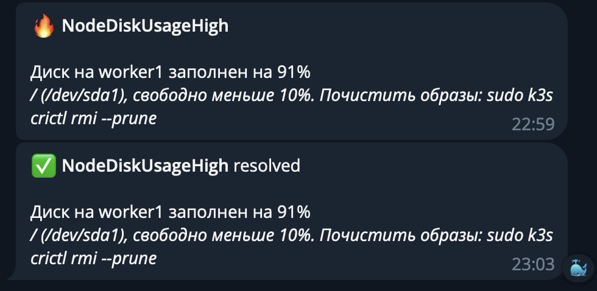

Alertmanager ставится в том же [kube-prometheus-stack](<../../metrics/kube-prometheus-stack/Prometheus и Grafana.md>), его конфиг в секции `alertmanager` в [values.yaml](../../metrics/kube-prometheus-stack/values.yaml). Уведомления уходят в Telegram.

Правила алертов считает Prometheus, Alertmanager только группирует сработавшие алерты, решает куда отправить и как часто повторять.

Настройку бота, воркера и проверки в проекте можете найти здесь: [zero-to-cluster → Alert Manager](https://github.com/kuzz0k/zero-to-cluster/blob/main/docs/setup/Monitoring.md#alert-manager), сам воркер в [infra/cloudflare](https://github.com/kuzz0k/zero-to-cluster/tree/main/infra/cloudflare).

### Правила

Правило это `PrometheusRule`. Из чарта приходит 30 PrometheusRule со 134 стандартными алертами (ноды, поды, kubelet, PVC, API server). Свое пока одно, [alerts.yaml](../../metrics/kube-prometheus-stack/extras/alerts.yaml): диск ноды заполнен больше чем на 90% в течение 10 минут.

```
        - alert: NodeDiskUsageHigh
          expr: |
            (
              1 - node_filesystem_avail_bytes{fstype=~"ext4|xfs|btrfs", mountpoint!~"/boot.*"}
                / node_filesystem_size_bytes{fstype=~"ext4|xfs|btrfs", mountpoint!~"/boot.*"}
            ) * 100
            * on (instance) group_left (nodename) node_uname_info
            > 90
          for: 10m
          labels:
            severity: warning
```

`* on (instance) group_left (nodename) node_uname_info` - подтягивает имя ноды вместо ip.

В Grafana правила видны в Alerting → Alert rules (только чтение). Алерты в UI Grafana не создаю: у нее нет диска, пропадут после рестарта.

### Маршрутизация

```
alertmanager:
  config:
    route:
      group_by: ['alertname', 'nodename', 'namespace']
      group_wait: 30s
      group_interval: 5m
      repeat_interval: 4h
      receiver: 'null'
      routes:
        - receiver: 'null'
          matchers:
            - alertname =~ "Watchdog|InfoInhibitor"
        - receiver: telegram
          matchers:
            - severity =~ "warning|critical"
    receivers:
      - name: 'null'
      - name: telegram
        telegram_configs:
          - api_url: https://tg-proxy.<account>.workers.dev
            bot_token_file: /etc/alertmanager/secrets/alertmanager-telegram/bot-token
            chat_id: 123456789
            parse_mode: HTML
            send_resolved: true
```

- `warning` и `critical` в Telegram, `Watchdog`, `InfoInhibitor` и `info` глушатся в `null`
- пока алерт горит, повторяется раз в 4 часа, после решения приходит `resolved`
- существующая группа отправляется заново только раз в `group_interval`



### Telegram

1. В @BotFather `/newbot`, получаем токен
2. Написать боту `/start`, первым бот писать не может
3. `chat_id` берем из `https://api.telegram.org/bot<TOKEN>/getUpdates` и пишем в values

Токен в секрете, подключается в под через `alertmanagerSpec.secrets` и читается через `bot_token_file`:

```
kubectl -n monitoring create secret generic alertmanager-telegram --from-literal=bot-token='<TOKEN>'
```

```
  alertmanagerSpec:
    secrets:
      - alertmanager-telegram
```

##### Cloudflare Worker

Из сети кластера `api.telegram.org` недоступен, поэтому запросы идут через свой Cloudflare Worker, который просто проксирует в Telegram и пропускает только `sendMessage` и `getMe` моего бота, [tg-proxy-worker.js](tg-proxy-worker.js). Публичные зеркала Bot API не использую, токен идет в URL и владелец зеркала его получит.

Cloudflare → Workers & Pages → Create → Worker → Edit code, вставить скрипт → Deploy. URL воркера в `api_url`, без `/` в конце.

##### GODEBUG

Провайдер вешает TLS с постквантовым обменом ключами, который Go (с 1.24) предлагает по умолчанию: ClientHello больше одного пакета и соединение висит. curl на нодах такое не предлагает и проходит. Выключено для контейнера alertmanager:

```
    containers:
      - name: alertmanager
        env:
          - name: GODEBUG
            value: tlsmlkem=0,tlssecpmlkem=0
```

Проверка из пода, если `classic: 403`, а `post-quantum: 000` - оно:

```
kubectl run tlstest --rm -it --restart=Never --image=curlimages/curl -- sh -c \
'U=https://tg-proxy.<account>.workers.dev/; curl -m 10 -s -o /dev/null -w "classic: %{http_code}\n" --curves X25519 $U; curl -m 10 -s -o /dev/null -w "post-quantum: %{http_code}\n" --curves X25519MLKEM768 $U'
```

### Проверка

Бот, воркер и чат (токен из секрета, в историю не попадает):

```
TOKEN=$(kubectl -n monitoring get secret alertmanager-telegram -o jsonpath='{.data.bot-token}' | base64 -d)
curl -m 10 -s "https://tg-proxy.<account>.workers.dev/bot$TOKEN/sendMessage" -d chat_id=<CHAT_ID> -d text=test
```

Тестовый алерт напрямую в Alertmanager, приходит через ~30 секунд, `resolved` через 5 минут. Для повтора менять `alertname`:

```
kubectl -n monitoring port-forward svc/monitoring-kube-prometheus-alertmanager 9093
curl -XPOST localhost:9093/api/v2/alerts -H 'Content-Type: application/json' \
-d '[{"labels":{"alertname":"TestAlert","severity":"warning"},"annotations":{"summary":"Тестовый алерт"}}]'
```

Проверка правила на диск, забиваем ноду до 91% (выше 95% не забивать, kubelet начнет выселять поды):

```
read size avail < <(df -B1 --output=size,avail / | tail -1); fill=$(( avail - size*9/100 ))
sudo fallocate -l $fill /var/tmp/fill-disk && df -h /
# через 10 минут Firing, потом убрать
sudo rm /var/tmp/fill-disk
```

### Если не приходит

```
kubectl -n monitoring logs alertmanager-monitoring-kube-prometheus-alertmanager-0 -c alertmanager --since=15m \
| sed -E 's/bot[0-9]+:[A-Za-z0-9_-]+/bot<REDACTED>/g' | grep -iE "notify|error"
```

- `connection timed out` до `api.telegram.org` - нет `api_url` на воркер
- `//bot...` в URL - `/` в конце `api_url`
- `Forbidden: bot can't initiate conversation` - не нажат `/start`
- `chat not found` - неверный `chat_id`
- `TLS handshake timeout` до `workers.dev` - см. GODEBUG выше

Если values запушили раньше, чем создали секрет, алерты могут висеть в pending. Удаляем под, Argo CD поднимет с новыми значениями.

Alertmanager при ошибке пишет в лог полный URL с токеном. Alloy вырезает его до отправки в Loki (`stage.replace` в [alloy-values.yaml](../../logging/loki-alloy/alloy-values.yaml)). Если токен утек - `/revoke` в BotFather и обновить секрет:

```
kubectl -n monitoring create secret generic alertmanager-telegram --from-literal=bot-token='<NEW_TOKEN>' --dry-run=client -o yaml | kubectl apply -f -
kubectl -n monitoring delete pod alertmanager-monitoring-kube-prometheus-alertmanager-0
```
