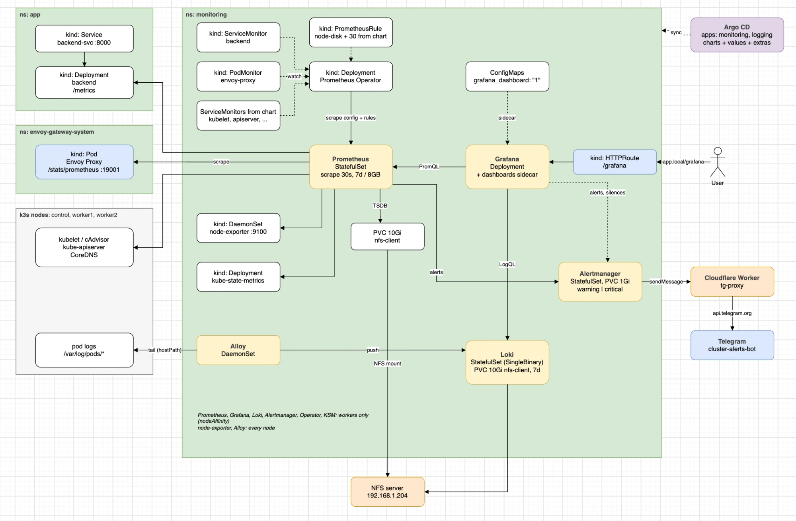

[kube-prometheus-stack](https://github.com/prometheus-community/helm-charts/tree/main/charts/kube-prometheus-stack)

Один Helm чарт: Prometheus Operator, Prometheus, Alertmanager, Grafana, node-exporter и kube-state-metrics. Отдельные чарты Prometheus и Grafana не брал, тут они уже связаны, плюс готовые дашборды и алерты под кубер. Все в namespace `monitoring`, ставится через Argo CD.



Файлы:
- [application.yaml](application.yaml) - Argo CD Application: чарт + values + extras
- [values.yaml](values.yaml) - values чарта
- [extras/](extras) - namespace, HTTPRoute Grafana, ServiceMonitor/PodMonitor, свои правила алертов, дашборды
- Alertmanager и Telegram - в [Alertmanager](../../alerting/alertmanager/Alertmanager.md)

Как мониторинг устроен в проекте и установку по шагам можете найти в zero-to-cluster: [архитектура](https://github.com/kuzz0k/zero-to-cluster/blob/main/docs/architecture-overview/Monitoring.md), [установка](https://github.com/kuzz0k/zero-to-cluster/blob/main/docs/setup/Monitoring.md). Бэкенд, который отдает `/metrics`, лежит в [backend](https://github.com/kuzz0k/zero-to-cluster/tree/main/backend).

### Установка

Секрет с логином Grafana создается руками и в git не попадает:

```
kubectl create namespace monitoring
kubectl -n monitoring create secret generic grafana-admin \
  --from-literal=admin-user=admin \
  --from-literal=admin-password='<пароль>'
```

Если секрет создать после приложения, Grafana будет в `CreateContainerConfigError`, пока он не появится.

`values.yaml` и `extras/` должны быть запушены в репу до создания приложения.

```
kubectl apply -f application.yaml
kubectl -n argocd get application monitoring
kubectl -n monitoring get pods,pvc -o wide
```

Первый запуск занимает несколько минут, ноды тянут образы.

### Как Prometheus находит таргеты

Prometheus сам не знает, что скрейпить. Таргеты описываются через `ServiceMonitor` и `PodMonitor`, оператор их видит и пересобирает конфиг. Чтобы добавить сервис в мониторинг, достаточно положить ServiceMonitor, конфиг Prometheus не трогать.

Чтобы Prometheus брал мониторы из любого ns и без лейбла `release`:

```
prometheus:
  prometheusSpec:
    serviceMonitorSelectorNilUsesHelmValues: false
    podMonitorSelectorNilUsesHelmValues: false
    ruleSelectorNilUsesHelmValues: false
    probeSelectorNilUsesHelmValues: false
```

Свои мониторы, [monitors.yaml](extras/monitors.yaml):
- `ServiceMonitor backend` - FastAPI отдает `/metrics` через prometheus-fastapi-instrumentator, ищется сервис с `app: backend` в ns `app`. Отсюда RPS, ошибки и латентность
- `PodMonitor envoy-proxy` - скрейпит `/stats/prometheus` у подов Envoy, через него идет весь входящий HTTP, видно трафик по каждому HTTPRoute

```
apiVersion: monitoring.coreos.com/v1
kind: ServiceMonitor
metadata:
  name: backend
  namespace: monitoring
spec:
  namespaceSelector:
    matchNames:
      - app
  selector:
    matchLabels:
      app: backend
  endpoints:
    - port: http          # имя порта в Service
      path: /metrics
      interval: 30s
```

Service используется только чтобы найти поды, скрейпится каждый под напрямую по IP.

Из чарта сразу скрейпятся node-exporter (ноды), kubelet/cAdvisor (CPU и память контейнеров), kube-state-metrics (состояние подов, деплойментов, PVC), kube-apiserver и CoreDNS.

Prometheus наружу не выставлен, таргеты смотрим через port-forward на `http://localhost:9090/targets`, все должны быть `UP`:

```
kubectl -n monitoring port-forward svc/monitoring-kube-prometheus-prometheus 9090
```

### Нюансы k3s

controller-manager, scheduler, kube-proxy и etcd в k3s живут внутри одного бинарника и слушают 127.0.0.1, поэтому выключены, иначе висят в Prometheus как down:

```
kubeControllerManager:
  enabled: false
kubeScheduler:
  enabled: false
kubeProxy:
  enabled: false
kubeEtcd:
  enabled: false
```

### Ресурсы и размещение

Стек ест ~1-1.5 GB. На control ноде с 3 GB вместе с k3s и Argo CD кончилась память и API server перестал отвечать (`TLS handshake timeout`). Поэтому все тяжелое через nodeAffinity только на воркерах, на control только node-exporter:

```
  affinity: &workers-only
    nodeAffinity:
      requiredDuringSchedulingIgnoredDuringExecution:
        nodeSelectorTerms:
          - matchExpressions:
              - key: node-role.kubernetes.io/control-plane
                operator: DoesNotExist
```

У всех контейнеров requests и лимиты по памяти: Prometheus до 1 GB, Grafana до 768 MB. Скрейп раз в 30 секунд.

```
kubectl top nodes
```

### Хранение

Prometheus и Alertmanager на PVC из `nfs-client`. Метрики 7 дней, но не больше 8 GB:

```
    retention: 7d
    retentionSize: 8GB
    storageSpec:
      volumeClaimTemplate:
        spec:
          storageClassName: nfs-client
          accessModes: ["ReadWriteOnce"]
          resources:
            requests:
              storage: 10Gi
```

TSDB на NFS в проде не делают (возможна порча данных), для лабы нормально.

### Grafana

Grafana сама ничего не хранит, при открытии дашборда шлет PromQL запросы в Prometheus. Диска у нее нет (`persistence.enabled: false`): дашборды и datasource подтягиваются из ConfigMap при старте, пароль из секрета.

Открывается на `app.local/grafana` через Envoy Gateway, [grafanaHTTPRoute.yaml](extras/grafanaHTTPRoute.yaml). Для этого:

```
grafana:
  grafana.ini:
    server:
      domain: app.local
      root_url: "%(protocol)s://%(domain)s/grafana/"
      serve_from_sub_path: true
```

Loki вторым datasource:

```
  additionalDataSources:
    - name: Loki
      type: loki
      uid: loki
      url: http://loki.monitoring.svc:3100
      access: proxy
```

##### Дашборды

Лежат json файлами в [extras/dashboards](extras/dashboards), Kustomize делает из них ConfigMap ([configMapGenerator](../../../packaging/kustomize/Kustomize.md#configmapgenerator)). Sidecar Grafana находит ConfigMap с лейблом `grafana_dashboard: "1"`, аннотация `grafana_folder` раскладывает по папкам:

```
  sidecar:
    dashboards:
      folderAnnotation: grafana_folder
      provider:
        foldersFromFilesStructure: true
```

Дашборд, собранный руками в UI, после рестарта пропадет, поэтому экспортируем в json и коммитим.

Мои дашборды:
- `node-use` - ноды по методу USE (Utilization, Saturation, Errors)
- `gateway-http` - трафик через Envoy по HTTPRoute
- `backend-red` - бэкенд по методу RED (Rate, Errors, Duration)
- `k8s-logs` - логи из Loki, см. [Loki и Alloy](<../../logging/loki-alloy/Loki и Alloy.md>)

### Проблемы

**Grafana `OOMKilled` / 2 из 3 контейнеров ready.** На лимите 384Mi упиралась в `GOMEMLIMIT` и не успевала ответить на readiness пробу (таймаут 1s), Argo CD показывал `Progressing`. Лимит поднял до 768Mi, таймаут пробы до 5s:

```
  readinessProbe:
    timeoutSeconds: 5
    failureThreshold: 3
```

**DiskPressure и выселение подов.** Порог выселения 5% свободного места. Почти весь диск нод занимают образы, сами метрики и логи на NFS. Диски нод поднял с 10 до 20 GB. После снятия taint `disk-pressure`:

```
kubectl -n monitoring delete pod --field-selector=status.phase=Failed
```

Слабое место: мониторинг живет на тех же нодах, за которыми следит. Если поды выселит DiskPressure, выселен будет и сам Prometheus, и алерт может не прийти.
