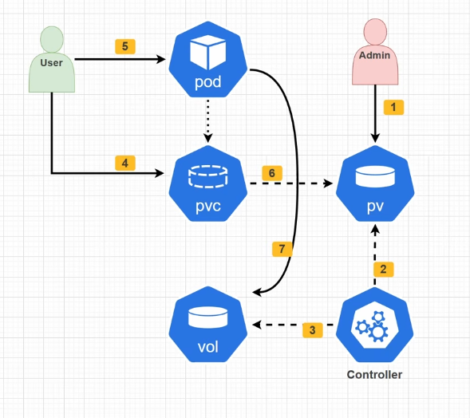
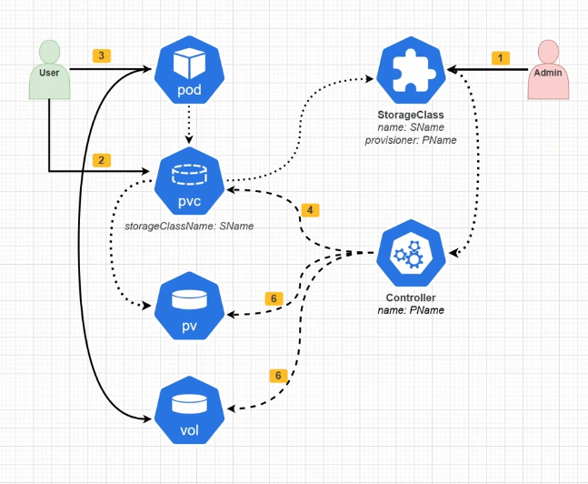

### Создание PV руками

Сначала админ создает манифест в котором описывает сам `Persistent Volume`. Далее `Controller` похватывает изменения и создает `volume`. Пользователь также прописывает манифест с `Persistent Volume Claim`, чтобы `PVC` через bind подключиться к `PV`. После этого пользователь создает под, где указывает `PVC` в `volume`

### Динамическое создание

Здесь уже админ Админ создаёт `StorageClass`, где описывает **как создавать storage**: какой provisioner/CSI-драйвер использовать (`NFS`, AWS EBS, Ceph и т. д.) и параметры.

У пользователя меняется лишь то, что он должен теперь указывать `storageClassName: SName`. Но меняется порядок создания `PV`, он создается по запросу `PVC`

То есть порядок действительно меняется:

**Статически:**  
`Admin → PV → PVC → Pod`

**Динамически:**  
`Admin → StorageClass`  
`User → PVC → StorageClass → Volume + PV → Pod`

### Persistent Volume 

Это абстракция над физическим хранилищем в кластере.

### Жизненный цикл

Есть несколько состояний:
- `Available` - Доступен и создан, но не связан еще (PVC)
- `Bound` - Связан с PVC, готов к работе с подом
- `Released` - Освобожден, PVC, с которым был связан PV удален, что будет с данными зависит от политики, описанной в манифесте
- `Failed` - Сбой или PV недоступен

### Политика возврата (Reclaim policy)

Определяет то, что будет с PV после отвязки или удаления PVC

- `Retain` - PV остается и переходит в состояние `released` и требует вмешательство администратора для удаления или повторного использования
- `Delete` - удаляет, используется в основном при динамическом выделении ресурсов
- `Recycle` - устарела, удаляла все данные и переходила снова в available, лучше использовать динамическое выделение ресурсов

### Режимы доступа (Access Modes)

Определяет как поды обращаются к тому, один PV может иметь несколько режимов доступа

- `ReadWriteOnce (RWO)` - том может быть смонтирован для чтения и записи только для одиного узла (все поды на этом узле)
- `ReadOnlyMany (ROX)` - том может быть смонтирован для чтения многими узлами одновременно
- `ReadWriteMany (RWX)` - том может быть смонтирован для чтения и записи многими узлами одновременно, но его поддерживают не все хранилища
- `ReadWriteOncePod (RWOP)` - том может быть смонтирован для чтения и записи только одного пода в кластере