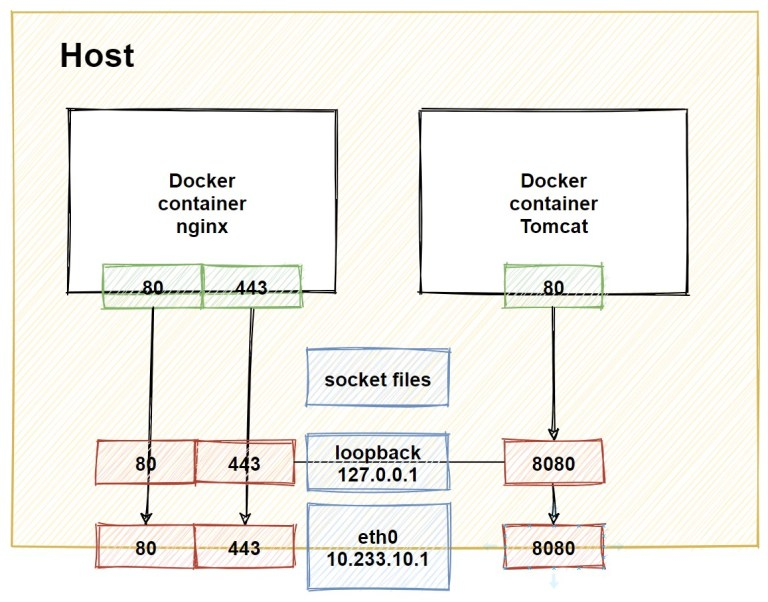
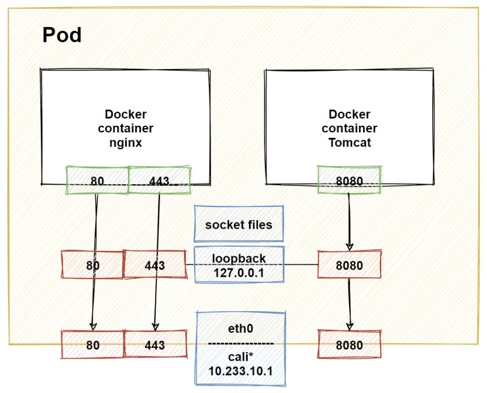
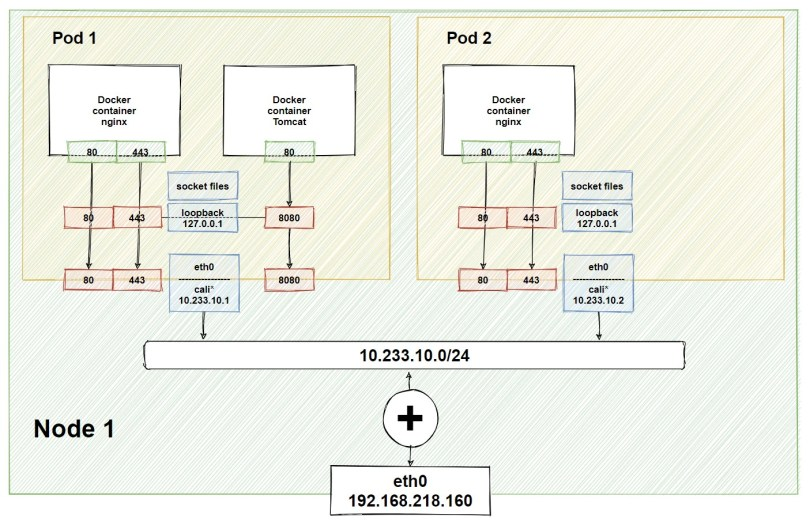
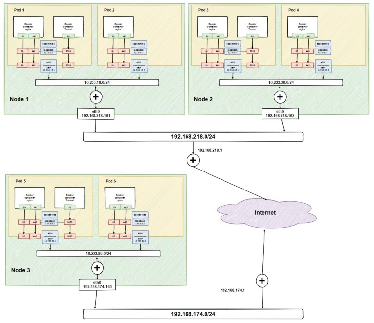

Основная задача - огранизовать сетевое взаимодействие между подами. 

Модель сети kubernetes подразумевает следующее:

- Каждый под имеет собственный IP адрес.
- Контейнеры внутри пода имеют общий IP адрес и могут свободно обмениваться пакетами друг с другом.
- Поды могут посылать пакеты другими подами в кластере, используя их IP адреса. Без применения NAT.
- Ограничения в хождении пакетов между подами определяется при помощи сетевых политик.

Таким образом, под можно представить как некую виртуальную машину со своим IP адресом. Контейнеры внутри пода, как приложения (процессы) в виртуальной машине, общаются друг с другом через loopback интерфейс или чере IPC.

Поскольку ограничения реализуются при помощи сетевых политик, то реализация самой сети остаётся достаточно простой. По сути, внутри кластера kubernetes мы получаем «плоскую» сеть. Разумеется, существует возможность отображать порты внутри пода на порты ноды кластера, а также запускать поды в пространстве сети хоста (например Linux).

### Docker container

Предположим, что у нас есть два контейнера: nginx и tomcat.

Nginx открывает на прослушивание 80 и 443-й порты. Tomcat – 80-й. Мы хотим, что бы эти два приложения были доступны по сети. Для этого нам нужно транслировать порты на сетевые интерфейсы хоста. Но и niginx и tomcat используют 80-й порт, и мы не можем «разделить» один порт между двумя приложениями. Поэтому при запуске контейнера tomcat мы транслируем порт хоста 8080 на 80-й порт контейнера.

Теперь, чтобы обратиться к tomcat можно обратиться на интерфейс eth0 на порт 8080: http://10.233.10.1:8080.

Также эти два приложения могут общаться друг с другом через loopback интерфейс.

### Pod

По суте свой сеть в поде такая же, как и у докера

Внутри пода мы можем запускать несколько контейнеров. Контейнеры могут общаться друг с другом через loopback интерфейс сети пода или через локальную файловую систему через файлы типа socket.

Для доступа к приложениям в контейнере мы публикуем порты на сетевой интерфейс контейнера. Точно так же, как и с простым компьютером мы должны позаботиться, чтобы порты были уникальными. Но в случае пода, должен быть уникальным порт самого контейнера. Двух контейнеров с одним открытым портом внутри пода быть не дролжно.

Согласно модели сети Kubernetes, условие «Контейнеры внутри пода имеют общий IP адрес и могут свободно обмениваться пакетами друг с другом» выполнено. Другое условие: «каждый под имеет собственный IP адрес» обеспечивает модуль IPAM сетевого драйвера kubernetes. Внутри пода приложения видят интерфейс eth0. Снаружи имя интерфейса на машине хоста зависит от используемого сетевого драйвера.

На рисунке изображен условный хост, на котором запущена worker node kuberntes. Предположим, что мы запустили два пода. Каждому поду был присвоен свой собственный ip адрес: 10.233.10.1 и 10.233.10.2. Это ip адреса внутренней сети, подключенной к bridge интерфейсу. В нашем примере сеть 10.233.10.0/24.

Третье условие гласит: «Поды могут посылать пакеты другими подами в кластере, используя их IP адреса. Без применения NAT». И мы видим, что приложения из пода 1 могут обращаться к приложениям пода по ip адресу 10.233.10.2. По пути у нас нет никаких nat преобразований. И наоборот, приложения пода 2 будут обращать к приложениям в поде 1.

Добавим несколько нод

На ноде 2 запущены еще два пода. В этой ноде будет своя внутренняя сеть. Она будет отличной от сети ноды 1, об этом позаботится драйвер сети Kubernetes (в этом примере у одной 10.233.10.0/24, у другой 10.233.30.0/24). Так же этот драйвер добавит в таблицы маршрутизации обеих нод, маршруты к этим сетям.

Например, на ноде 1 появится маршрут к сети 10.233.30.0/24 через ip 192.168.218.162. На ноде 2 маршрут к сети 10.233.10.0/24 через машину с ip 192.168.218.161.

Если мы добавим третью ноду, то аналогично на ней появится внутренняя сеть, и во всех нодах кластера добавятся маршруты к сетям.

Но в нашем примере третья нода находится не в локальной сети кластера, а где-то там в интернетах. Из схемы видно, что в сети, где размещен наш кластер и в сети третьей ноды используются ip адреса для внутренних сетей, маршрутов для которых нет в интернет. И для пересылки пакетов между нодами потребуются всякие хитрости в том числе и nat преобразования. Но третье условие запрещает нам использовать nat. Что же нам делать?

Что бы не нарушить третье условие, мы воспользуемся overlay сетями. Говоря проще, построим тоннели. Для этого используют ip-ip или VXLAN. В первом случае у нас происходит инкапсуляция пакетов ipv4 в ipv4. Во втором случае пакеты второго уровня инкапсулируются в UDP пакеты. На схема такой тоннель не нарисован, но для работы всех трех нод, нам потребуется сделать как минимум 2 тоннеля: нода 1 – нода 3 и нода 2 – нода 3. Но опять же, мы не будем делать их руками – это задача драйвера сети Kubernetes.