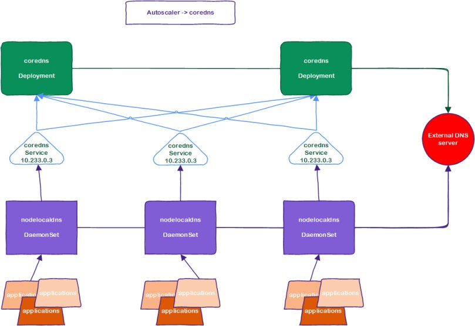

# Записи A и AAAA

- **A** → IPv4 (старый формат, например `8.8.8.8`)
- **AAAA** → IPv6 (новый формат, например `2001:4860:4860::8888`)

##### Для services

В системе можно выделить два типа сервисов: обычные и headless.

Обычным сервисам присваивается ip адрес, headless нет.

При обращении к обычному сервису, к его IP адресу, происходит NAT преобразование «подставляющее» IP адрес пода (подов).

headless service по своей сути – это запись типа А в DNS, указывающая непосредственно на IP пода.

Типичное FQDN имя сервиса:

```
service-name.namespace-name.svc.cluster.local
```

##### Для pods

FQDN имя для простого пода:

```
pod-ip-address.namespace-name.pod.cluster.local
```

Например:

```
10-233-79-186.default.pod.cluster.local
```

# Схема kubespray



Kubespray ставит следующие компоненты системы:

1. coredns – основной DNS сервер, отвечающий за разрешение имен внутри кластера Kubernetes.
2. nodelocaldns – кеширующий DNS сервер. По одному на каждую ноду кластера.
3. dns-autoscaler – приложение, автоматически увеличивающее или уменьшающее количество подов coredns в кластере ([https://github.com/kubernetes-sigs/cluster-proportional-vertical-autoscaler](https://github.com/kubernetes-sigs/cluster-proportional-vertical-autoscaler)).

Основным DNS сервером является coredns ([https://coredns.io](https://coredns.io)). На него ложится все преобразования внутри кластера DNS.

Для доступа и распределения запросов между подами coredns, создан соответствующий сервис. На самом деле сервис один, хотя на схеме показаны три штуки. Но мы знаем, что сервис – это набор правил NAT преобразований на каждой ноде кластера.

Nodelocaldns выполнен в виде daemonSet. Это значит, что по одному экземпляру пода будет запущено на каждом кластере сети. Задача nodelocaldns – кеширование запросов от приложений, расположенных на ноде.

Файлы манифестов всех системных компонент кластера, установленного при помощи kubespray, можно найти в директории /etc/kubernetes. В том числе configMaps системы DNS: coredns-config.yml, nodelocaldns-config.yml.

Рассмотрим конфигурацию coredns.

```
.:53 {
  errors
    health {
    lameduck 5s
  }
  ready
  kubernetes cluster.local in-addr.arpa ip6.arpa {
    pods insecure
    fallthrough in-addr.arpa ip6.arpa
  }
  prometheus :9153
  forward . /etc/resolv.conf {
    prefer_udp
  }
  cache 30
  loop
  reload
  loadbalance
}
```

Как видно из файла, сервер отвечает на все запросы на 53 порту. Модуль Kubernetes отвечает за домен cluster.local и обратные преобразования. Все остальные запросы будут пересылаться на DNS сервера, описанные в файле /etc/resolv.conf того компьютера, на котором запущен этот под.

Модуль кubernetes реализует концепцию Kubernetes DNS-Based Service Discovery ([https://github.com/kubernetes/dns/blob/master/docs/specification.md](https://github.com/kubernetes/dns/blob/master/docs/specification.md)).

Кеширующий DNS сервер тоже реализован с использованием coredns, но с другой конфигурацией.

```
cluster.local:53 {
  errors
  cache {
    success 9984 30
    denial 9984 5
  }
  reload
  loop
  bind 169.254.25.10
  forward . 10.233.0.3 {
    force_tcp
  }
  prometheus :9253
  health 169.254.25.10:9254
}
in-addr.arpa:53 {
  errors
  cache 30
  reload
  loop
  bind 169.254.25.10
  forward . 10.233.0.3 {
    force_tcp
  }
  prometheus :9253
}
ip6.arpa:53 {
  errors
  cache 30
  reload
  loop
  bind 169.254.25.10
  forward . 10.233.0.3 {
    force_tcp
  }
  prometheus :9253
}
.:53 {
  errors
  cache 30
  reload
  loop
  bind 169.254.25.10
  forward . /etc/resolv.conf
  prometheus :9253
}
```

Обратите внимание на схеме приложения обращаются напрямую на 53-й порт DNS сервера. Service для доступа к подам не определен.

Основная задача кеширущего сервера – получать запросы от приложений, расположенных непосредственно на ноде. Если определить сервис, то мы не сможем ограничить запросы только на данный сервер. Поэтому разработчики пошли на хитрость:

```
bind 169.254.25.10
```

Сеть 169.254.0.0/16 – это так называемая Link-Local (см. RFC 3927). Подсети link-local не маршрутизируются: маршрутизаторы не должны отправлять пакеты с адресами link-local в другие сети. Система поднимает IP 169.254.25.10 на каждой ноде. С другой стороны, DaemonSet запускает на каждой ноде под nodelocaldns, в котором DNS сервер будет открывать 53-й порт на этом IP.

В результате, на каждой ноде мы получаем кеширующий DNS сервер, находящийся на одном и том же IP. Теперь достаточно сконфигурировать resolver в каждом поде на использование DNS на IP 169.254.25.10.

Запросы к внутренним зонам кластера (cluster.local, in-addr.arpa и ip6.arpa), будут пересылаться на service coredns. Но поскольку мы настраиваем пересылку в DNS сервере, мы должны использовать IP адрес сервиса. В kubespray по умолчанию это 10.233.0.3.

Еще один интересный момент:

```
force_tcp
```

Кеширующие DNS сервера ходят к coredns по протоколу TCP. Разработчики говорят, что в связи с большим количеством NAT преобразований внутри сети Kubernetes, использование TCP ускоряет доставку запросов.

Запросы на все остальные домены пересылаются на DNS сервера, определённые в стандартных файлах /etc/resolv.conf, находящихся на нодах, где запущены поды nodelocaldns. Важно отметить, что данные из этих файлов читаются только при старте пода. Поэтому внесение изменений в resolv.conf не повлияет на работу кеширующего DNS сервера. Поэтому, после изменения этого файла, перезапустите nodelocaldns на этой ноде.
