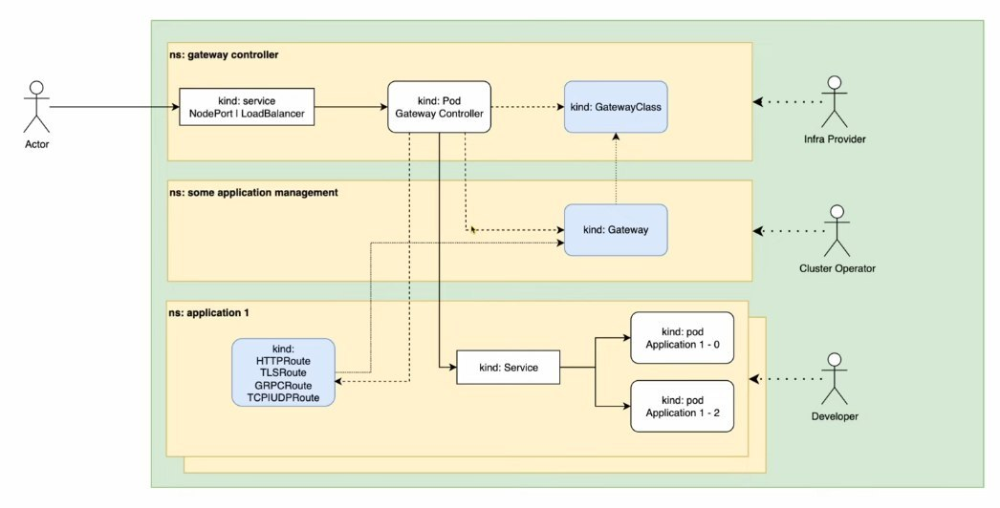

По сути пришел на замену Ingress Controller

[Документация](https://gateway-api.sigs.k8s.io/docs/introduction/)

На картинке представлен пример Traefik, например у Envoy схема будет иная

Гланые отличия: не привязан к ns, более ограниченные права для разработчиков, вынесли отдельно GRPC, 
##### Сетевой трафик

Ничего в целом не меняется. Входящий через service попадает на controller, согласно GatewayClass, Gateway и Route киндам контроллер конфигурирует свою работу и в зависимости от инбаунда прокидывает трафик на нужный сервис

##### Доступы

Три роли - Infra Provider (супер админ), Cluster Operator (отвественный за часть кластера), Developer (самый простой)

##### Infra Provider
Есть некий Controller, который реализует реакцию на новые типы kind, есть GatewayClass (тот же IngressClass) - можно запустить также несколько контроллеров, но нужно указать какой контроллер использует какой класс. Контроллер также выводится наружу, обычно через NodePort или LoadBalancer. Вообщем часть Infra **ничем не отличается**

Человек, который готовит в кластере контроллеры и назначает им классы, его задача организовать инфру
##### Cluster Operator
Работает на уровне Gateway, определяет входные точки (inbound) для контроллера и ссылается на класс. Также он определяет кто может пользоваться этим gateway, т. е. определяет роли (ns, kind которые могут подключаться)
##### Developer
Эта часть также похожа на Ingress, только в kind может быть не только HTTP. Это и была главная проблема по мнению разработчиков GW API - Ingress пропускает только HTTP/HTTPS трафик. 

Разработчик ссылается на gateway, 

