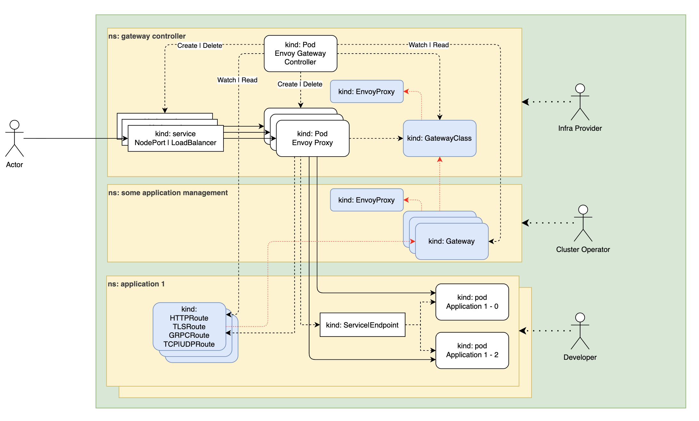

[Envoy Gateway](https://gateway.envoyproxy.io)



Как Envoy и MetalLB работают в проекте с приложением, можете найти в zero-to-cluster: [архитектура сети](https://github.com/kuzz0k/zero-to-cluster/blob/main/docs/architecture-overview/Network.md), [установка](https://github.com/kuzz0k/zero-to-cluster/blob/main/docs/setup/Network.md), [манифесты](https://github.com/kuzz0k/zero-to-cluster/tree/main/app-deploy/kubernetes/manifests/cluster/network).

В отличие от Traefik, где LoadBalancer сервис и прочее создавалось автоматически, Envoy использует отдельный контроллер, который смотрит, что мы написали в манифестах и создает поды Envoy Proxy, причем их количество определяется количеством kind Gateway, автоматически создается такое же количество сервисов (по-умолчанию LB)

Т.е. Envoy Proxy - диннамическая кофигурации proxy киндов. Их можно запускать отдельно для Gateway, GatewayClass

### Установка Envoy

[Installation](https://gateway.envoyproxy.io/docs/tasks/quickstart/#installation)

Через helm:

```
helm install eg oci://docker.io/envoyproxy/gateway-helm --version v1.9.2 -n envoy-gateway-system --create-namespace
```

### Envoy Proxy

[Envoy Proxy](https://gateway.envoyproxy.io/docs/api/extension_types/#envoyproxy)

Для каждого `Gateway` будет создаваться отдельный экземпляр прокси envoy. Конфигурация прокси происходит при помощи `kind: EnvoyProxy`. Это особенность непосредственно envoy и никакого отношения к GatewayAPI не имеет.

Конфигурацию можно привязать к `GatewayClass`. Тогда она будет распространяться на все экземпляры envoy proxy, относящиеся к этому классу. Либо делать отдельную конфигурацию для каждого экземпляра `Gateway`. Т.е. для отдельного экземпляра envoy.

В манифесте есть дополнительное логирование, а также `externalTrafficPolicy`. `externalTrafficPolicy` бывает Local и Cluster. Отличие в том, что Local направляет трафик только к тем подам, которые находятся на этой же ноде, Cluster направляет на все поды кластера.
[#### KubernetesServiceSpec](https://gateway.envoyproxy.io/docs/api/extension_types/#kubernetesservicespec)

Запустим сначала Proxy

Далее GatewayClass

### Gateway

Что Gateway, что HTTPRoute будут похожи на Traefik

### Установка MetalLb

Она будет идентичной как в Traefik: [Traefik + MetalLB → Установка MetalLB](../traefik-metallb/Traefik%20+%20MetalLB.md#установка-metallb)

### Пока нет MetalLB

Без внешнего IP у Gateway будет `AddressNotAssigned` (`No addresses have been assigned to the Gateway`), а сервис Envoy в `<pending>`. Но NodePort ему уже назначен, так что проверить можно через ip любой ноды:

```
kubectl -n envoy-gateway-system get svc
curl -k -H "Host: app.local" https://192.168.1.203:32254/
```

### ClientTrafficPolicy

По умолчанию Envoy декодирует `%2F` обратно в `/`, склеивает `//` и редиректит. UI Argo CD передает URL репозитория прямо в пути (`/api/v1/repositories/https%3A%2F%2F.../helmcharts`) и после такой нормализации получает 404. Политика оставляет путь как есть, [client-traffic-policy.yaml](client-traffic-policy.yaml):

```
spec:
  targetRefs:
    - group: gateway.networking.k8s.io
      kind: Gateway
      name: envoy
  path:
    escapedSlashesAction: KeepUnchanged
    disableMergeSlashes: true
```

### k3s ServiceLB

Встроенный в k3s ServiceLB конфликтует с MetalLB за LoadBalancer сервис Envoy: его поды `svclb-envoy-*` пытаются занять 80/443 на каждой ноде и висят NotReady (алерты `KubePodNotReady`, `KubeDaemonSetRolloutStuck`). k3s нужно ставить с `--disable servicelb`.
