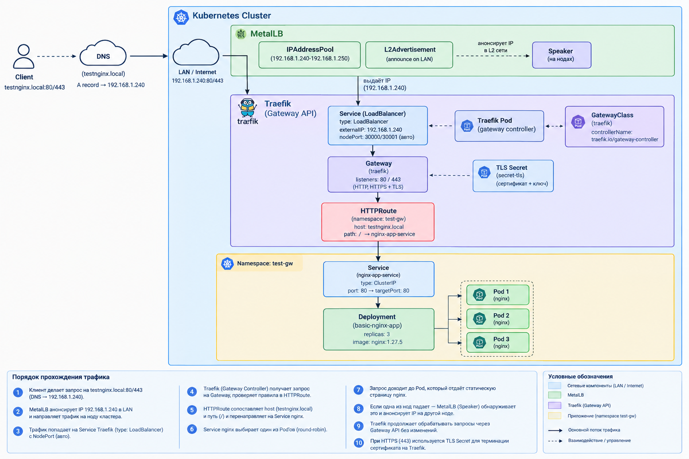

[Traefik Gatewat API](https://doc.traefik.io/traefik/reference/routing-configuration/kubernetes/gateway-api/)

Создадим ns, deployment, service и configMap (по-желанию для недефолтной страницы html)

Убедимся, что всё создалось:

```
kubectl -n test-gw get pods
kubectl -n test-gw get svc

# локально в кластере проверим доступ, предварительно пробросив порт через port-forward

kubectl port-forward svc/nginx-app-service 8080:80
curl http://localhost:8080
```

### Установка Traefik Gateway API

Начальная установка потребует helm и полностью соответствует документации 

[Установка Traefik GW API](https://doc.traefik.io/traefik/setup/kubernetes/)

Если запускать в k3s кластере, то может возникнуть ошибка, потому что helm ссылается по-умолчанию на `~/.kube/config`, а k3s ставит конфиг в `/etc/rancher/k3s/k3s.yaml`. Чтобы исправить - просто скопируем конфиг:

```
mkdir -p ~/.kube
sudo cp /etc/rancher/k3s/k3s.yaml ~/.kube/config
sudo chown $(id -u):$(id -g) ~/.kube/config
chmod 600 ~/.kube/config
```
### Создание Gateway API

Применим манифест и проверим, что всё применилось:

```
kubectl get pods -n traefik
kubectl get svc -n traefik
kubectl get gatewayclass
kubectl -n traefik get gateway
```

Проверим сразу доступ через nodePort:

```
curl -k -H "Host: testnginx.local" https://127.0.0.1:30001/
curl -k -H "Host: testnginx.local" https://127.0.0.1:30000/
```

По-умолчанию из доки http будет сразу редиректиться на https, если надо отключить, то в values.yaml необходимо удалить redirections:

```
ports:
  # Defines the HTTP entry point named 'web'
  web:
    port: 80
    nodePort: 30000
    # Instructs this entry point to redirect all traffic to the 'websecure' entry point
    http:
      redirections:
        entryPoint:
          to: websecure
          scheme: https
          permanent: true
```

### Установка MetalLB

[MetalLB](https://metallb.io/installation/)

Если необходимо нужно включить strict APR для kube-proxy

Далее просто запускаем манифест из документации

```
kubectl apply -f https://raw.githubusercontent.com/metallb/metallb/v0.16.1/config/manifests/metallb-frr-k8s.yaml
```

Дожидаемся, пока все поды поднимутся:

```
kubectl get pods -n metallb-system
```

И создаем пулл адресов

```
---
apiVersion: metallb.io/v1beta1
kind: IPAddressPool
metadata:
  name: default-pool
  namespace: metallb-system
spec:
  addresses:
  - 192.168.1.180-192.168.1.185
---
apiVersion: metallb.io/v1beta1
kind: L2Advertisement
metadata:
  name: default-l2
  namespace: metallb-system
spec:
  ipAddressPools:
  - default-pool
```

Чтобы посмотреть какой адрес является входным взглянем на сервис, который привязан к поду контроллера, в данном случае svc traefik

```
root@control:~/manifests# kubectl -n traefik get svc

NAME      TYPE           CLUSTER-IP      EXTERNAL-IP     PORT(S)                      AGE

traefik   LoadBalancer   10.43.165.248   192.168.1.181   80:30000/TCP,443:30001/TCP   18h
```

Заметим, что metallb выдал `192.168.1.181` адрес, чтобы проверить работоспособность необходимо либо создать в /etc/hosts днс запись с ip и именем, которые мы задавали в HTTPRoute. Или же можно использовать curl:

```
curl -I -H "Host: testnginx.local" http://192.168.1.181
```

### Добавление HTTPS

Для того чтобы добавить HTTPS необходимо:
1. Создать сертификаты
2. Создать HTTPRoute для https

##### Создание сертификатов

```
openssl req -x509 -nodes -days 365 -newkey rsa:2048 \
  -keyout tls.key -out tls.crt \
  -subj "/CN=testnginx.local"
```

Далее нужно создать secret с этими сертификатами

```
kubectl create secret tls local-selfsigned-tls \
  --cert=tls.crt --key=tls.key \
  --namespace traefik
```

##### Создание HTTPRoute для https

```
---
apiVersion: gateway.networking.k8s.io/v1
kind: HTTPRoute
metadata:
  name: nginx-https
  namespace: test-gw
spec:
  parentRefs:
    - name: traefik
      namespace: traefik
      sectionName: https
      kind: Gateway

  hostnames:
    - testnginx.local

  rules:
    - matches:
        - path:
            type: PathPrefix
            value: /

      backendRefs:
        - name: nginx-app-service
          namespace: test-gw
          port: 80
```

Проверка:

```
kubectl -n test-gw get httproute

curl -k -H "Host: testnginx.local" https://192.168.1.181/
```
### Архитектура

