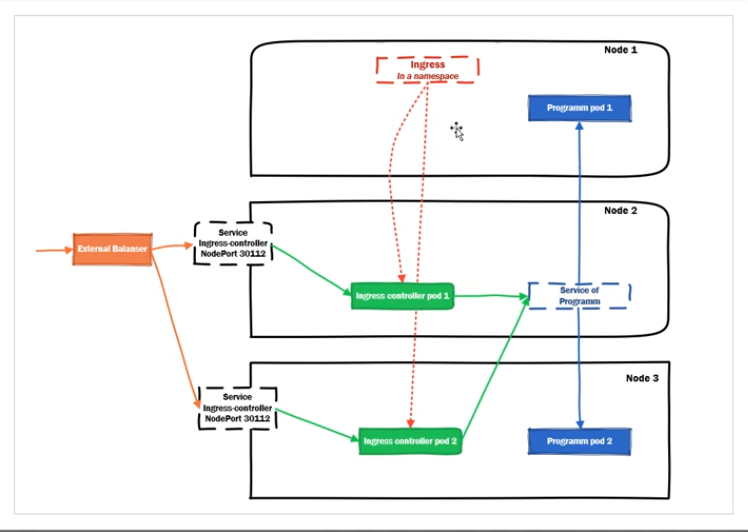
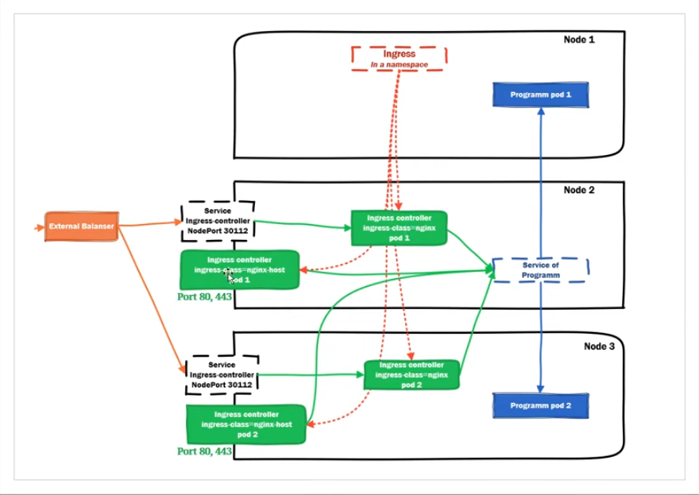

Ingress и Ingress controller это две разные вещи. 

Ingress - ничего не слушает и ничего не пропускает, это просто правила, в которых написано, что запросы на какой-то домен и какой-то путь нужно отправлять на такой-то сервис с таким-то сертификатом

```
apiVersion: networking.k8s.io/v1beta1
kind: Ingress
metadata:
  name: access-prometheus
  namespace: cattle-prometheus
spec:
  rules:
  - host: prometheus.kryukov.local
    http:
      paths:
	  - path: /api
	    backend:
          serviceName: access-prometheus
          servicePort: 80
```

Ingress Controller - это уже работающий proxy, который читает эти правила и принимает этот трафик 

### Через NodePort



В качестве контроллера будем использовать [Ingress nginx](https://kubernetes.github.io/ingress-nginx/deploy/)

### Через HostNetwork

В отличие от NodePort здесь можно будет посадить controller на 80/443 порты (NodePort работает в другом диапазоне)

Это небезопасно, так как попадая на ноду, можно получить доступ к кластеру через lookback интерфейс


