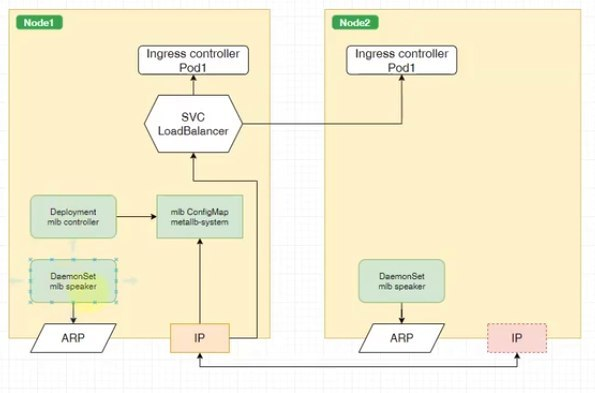

https://metallb.io/

Задача MetalLB в том, чтобы предоставить некий IP адрес сервису LoadBalancer. Сам он IP адреса не берет, ему нужно предоставить пул адресов, который он будет выдавать. 
Поддерживает ARP/NDP протоколы, если необходимо BGP (для маленьких кластеров будет избыточно)

В отличие от балансировщика MetalLB будет посылать весь трафик через одну ноду (мы используем IP адрес, он привязывается к машине) - узкое горлышко

Перераспределение IP довольно медленное, то есть если нода упала, новый IP появится не так быстро. MetalLB ставит спикеры на все машины, но он использует стандартный ARP. 

### Установка 

Убедится, что KubeProxy запущен с параметром:

```yaml
ipvs:
  strictARP: true
```

*Версию подставить актуальную на сайте*:

```shell
kubectl apply -f https://raw.githubusercontent.com/metallb/metallb/v0.10.2/manifests/namespace.yaml
kubectl apply -f https://raw.githubusercontent.com/metallb/metallb/v0.10.2/manifests/metallb.yaml
```

Только при первой установке создаём сикрет:

```shell
kubectl create secret generic -n metallb-system memberlist --from-literal=secretkey="$(openssl rand -base64 128)"
```

Применяем базовую конфигурацию layer2.

```shell
kubectl apply -f metallb/00-mlb.yaml
```

Добавляем сервис для ingres-controller типа LoadBalancer

```shell
kubectl apply -f metallb/01-lb-ingress-controller-svc.yaml
```

