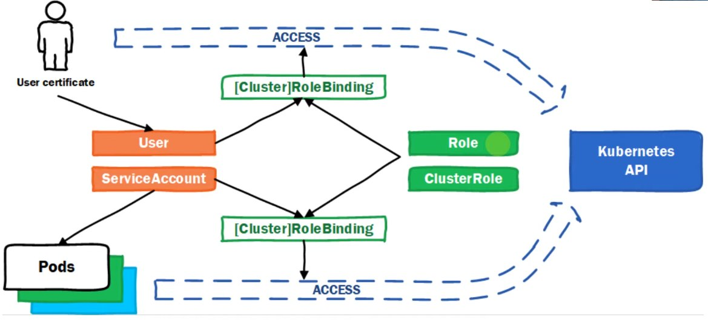

Role-based access control - нужен для ограничения прав пользователей (чтобы не давать всем sudo к кластеру)


### Для пользователей

В кластере напрямую нельзя создать пользователей и выдать им права, но мы можем выписать ему сертификат, на основании которого он будет входить в систему. 

После входа в систему пользователь по-умолчанию не имеет доступа к `k8s API`, нужно связать `User` и `Role`. Это делается при помощи `RoleBinding`

Порядок:
1. Создать сертификат для пользователя
2. Описать `Role`
3. Связываем `User` и `Role`

### Для приложений

Аутентификация приложений происходит за счет токенов, токены система генерирует автоматически. Когда приложение запускается, ему соотвествующий volume монтируется с этими токенами.

По-умолчанию приложение также ничего не получит от `k8s API`, нужно прописать `Role` или `ClusterRole` для доступов.

Чтобы связывать с ролью приложение используется сущность `ServiceAccount`. **ServiceAccount можно завести в системе, а User нет**

Если поду не добавляем `ServiceAccount` ему дается `default` 

### ServiceAccount

ServiveAccount используют для доступа к API Kubernetes из приложений.  
Когда в системе создаётся pod, ему по умолчанию присваивается default ServiceAccount текущего namespace.  
Посмотреть ServiceAccount в namespace можно следующим образом:

```
kubectl -n kubetest get serviceaccounts
```

Создать манифестом:

```
apiVersion: v1
kind: ServiceAccount
metadata:
  name: testaccount
  namespace: kubetest
# kubectl apply -f file.yaml
```

Если приложение (pod) запускается без явного указания ServiceAccount, ему присваивается ServiceAccount default.

Для определения ServiceAccount, при описании пода используйте serviceAccountName.

При запуске приложения ему автоматически подключается директория /var/run/secrets/kubernetes.io/serviceaccount в которой находятся файлы:

- ca.crt – сертификат CA кластера.
- Namespace – содержит имя namespace, в котором находится pod.
- token – содержит токен, используемый для доступа к API кластера.

Если вы хотите получать доступ к API кластера не из приложения, а, например из командной строки при помощи curl. Необходимо получить токен соответствующего ServiceAccount:

```
kubectl -n kubetest get secret $(kubectl -n kubetest get serviceaccount kubetest-account \
-o jsonpath="{.secrets[0].name}") -o jsonpath="{.data.token}" | base64 –decode
```

### RoleBinding

Нужен для связи `Role` или `ClusterRole` с `k8s API`

В `RoleBinding` (и в `ClusterRoleBinding`) поле `subjects` — это **массив**, поэтому в одном биндинге можно перечислить нескольких пользователей, группы и ServiceAccount’ы. Все они получат **одинаковые** права, которые описаны в `roleRef`.

```
apiVersion: rbac.authorization.k8s.io/v1
kind: RoleBinding
metadata:
  name: dev-limited-binding
  namespace: dev
subjects:
- kind: User
  name: alice
  apiGroup: rbac.authorization.k8s.io
- kind: User
  name: bob
  apiGroup: rbac.authorization.k8s.io
- kind: Group
  name: dev-team
  apiGroup: rbac.authorization.k8s.io
- kind: ServiceAccount
  name: ci-bot
  namespace: ci
roleRef:
  kind: Role
  name: dev-limited
  apiGroup: rbac.authorization.k8s.io
```

## Важные нюансы

- `roleRef` — **один** на весь `RoleBinding`. Если разным субъектам нужны разные права, создай несколько `RoleBinding` с разными `Role`.

- Для `User` и `Group` обязательно указывать:
```
apiGroup: rbac.authorization.k8s.io
```
- Для `ServiceAccount` указывается:
```
kind: ServiceAccount
name: <имя>
namespace: <namespace>
apiGroup: ""
```
- В `RoleBinding` ServiceAccount может быть из **другого** namespace. Тогда он получит права в namespace, где создан сам `RoleBinding`.
- Если использовать `ClusterRoleBinding`, то права будут выданы на весь кластер, а `subjects`работает так же.

Если у тебя есть, например:

- разработчики — только чтение;
- CI-бот — чтение и обновление ConfigMap;

то лучше сделать два отдельных `RoleBinding`